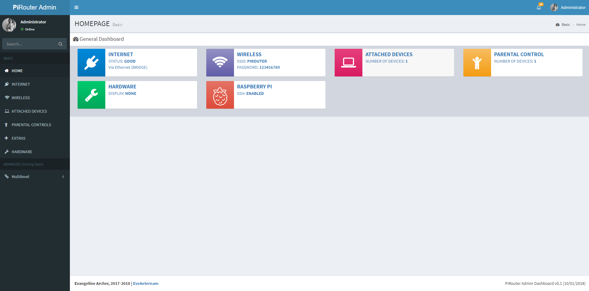
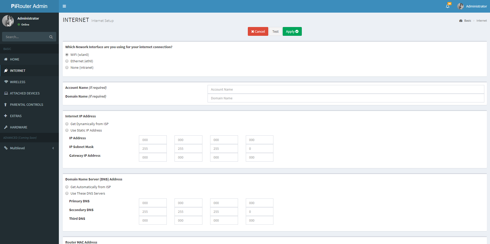
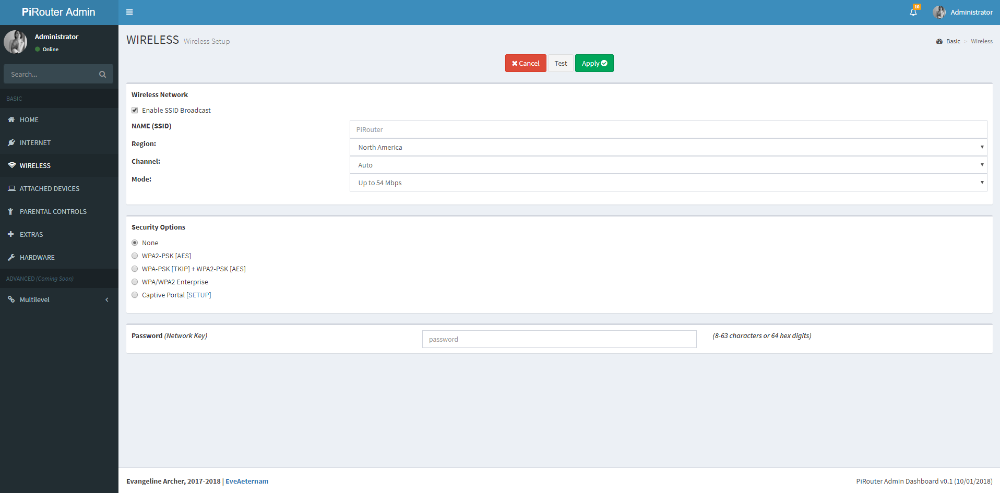
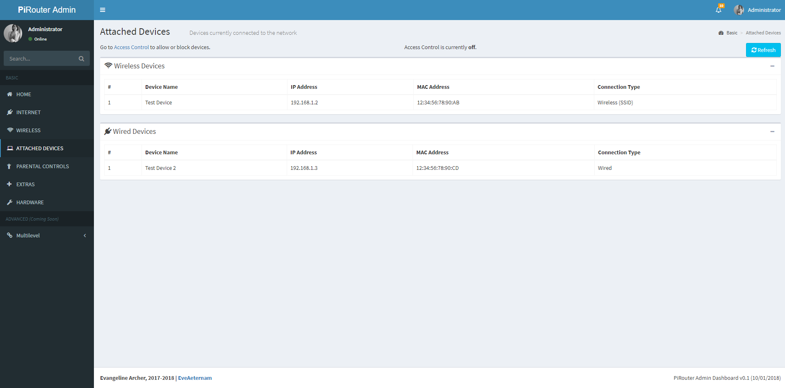
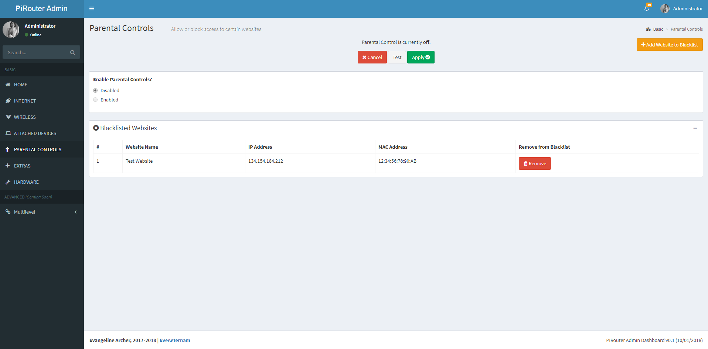
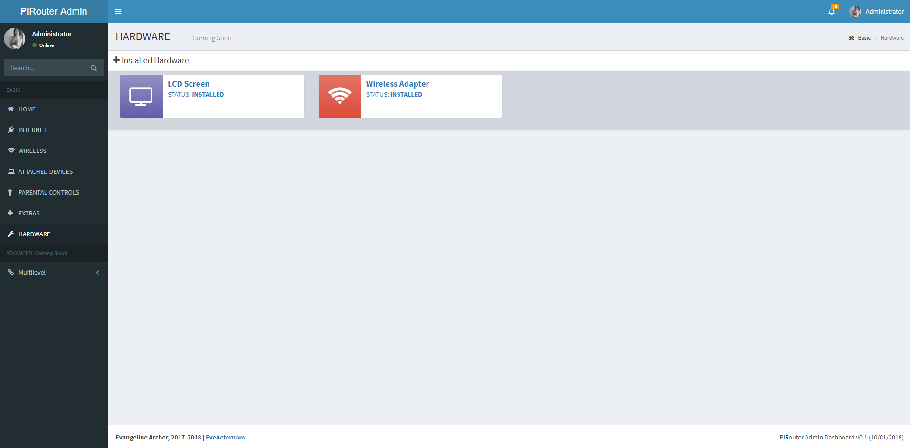

# Pi Router Admin

A web dashboard design for running a Raspberry Pi as a home router, from January 2018.

**Status: prototype, not maintained.** The pages are laid out and styled, and a small PHP + MySQL back end (`dist/php/`) reads the admin profile, Wi-Fi settings and notifications from a database and lets you add and remove sites on the parental-controls blacklist. Nothing applies those settings to the Pi itself: there is no hostapd, DHCP or firewall integration.

The pages are PHP files built on the [AdminLTE 2.4](https://adminlte.io/) template (Bootstrap 3), which supplies the layout, styles and the libraries in `bower_components/`, `dist/` and `build/`.

## Pages

| Page | File | Planned purpose |
|---|---|---|
| Home | `index.php` | Status at a glance |
| Internet | `internet.php` | WAN connection settings |
| Wireless | `wireless.php` | Wi-Fi network settings |
| Devices | `devices.php` | Attached clients |
| Parental controls | `parental.php` | Website blacklist |
| Hardware | `hardware.php` | Board status |
| Extras | `extras.php` | Other tools |
| Login, lock screen | `login.php`, `lockscreen.php` | Sign-in |

## Screenshots

| | |
|---|---|
|  |  |
|  |  |
|  |  |

## Run it
Needs PHP with `mysqli` and `curl`, and MySQL or MariaDB. Create a database named `pi-router`, import `dist/sql/pi-router.sql` (sample data), set the credentials in `dist/php/connect-sql.php`, then serve the folder (for example `php -S localhost:8000`) and open `index.php`.

Prototype code: the sample admin password is an unsalted MD5 hash, and the blacklist fetches whatever URL it is given. Don't expose it to a network you don't trust.

## License
MIT. The AdminLTE template is © 2014–2017 Abdullah Almsaeed, also MIT; see `LICENSE`.
